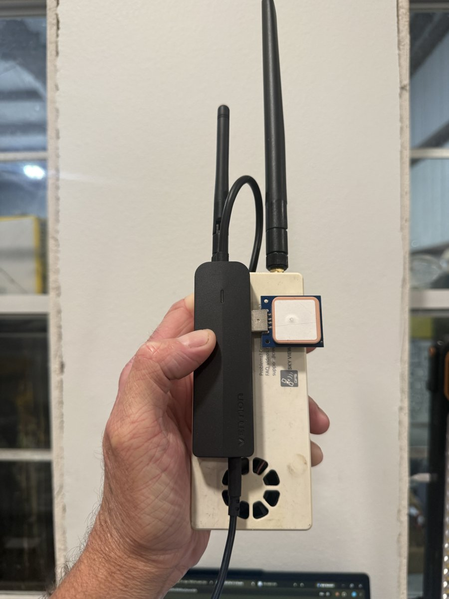
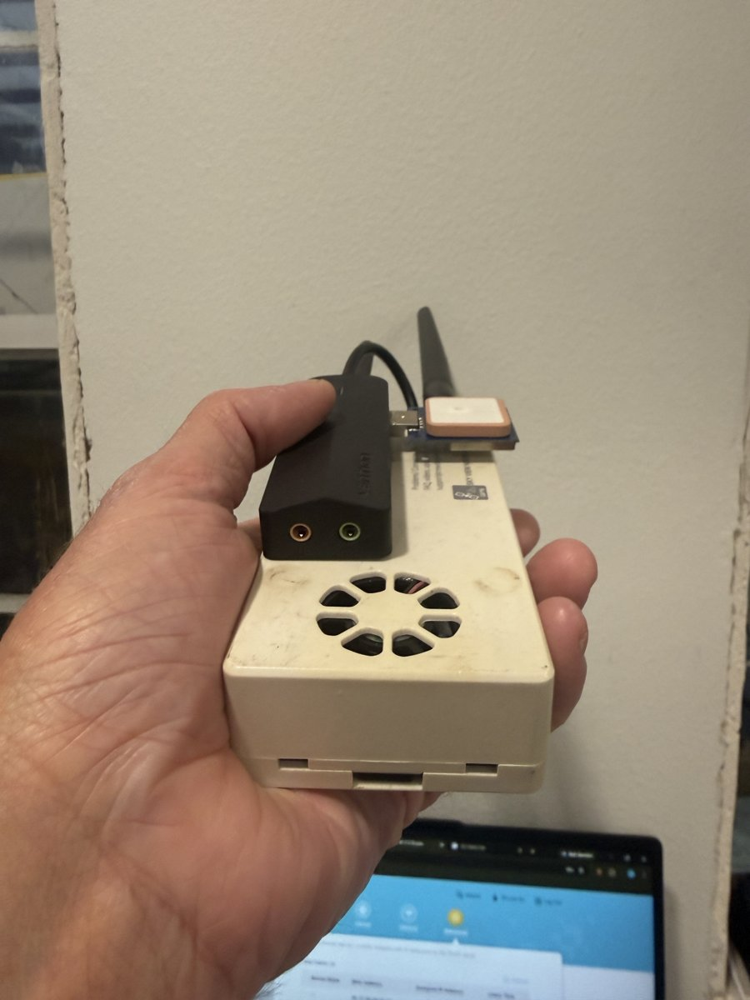

# StratuxAudio

Play music (or any iPhone audio) to your headset through your **Stratux**, over AirPlay,
while the iPhone stays on the Stratux Wi-Fi for traffic and weather.

The Stratux shows up in the iPhone's AirPlay list as **"Stratux Audio"**. Sound comes out
of a USB sound dongle on the Pi, into the intercom's music input.

**Traffic comes first.** The audio service runs at low priority and is capped at half of
one CPU core, so the ADS-B decoders always win. Check this on the ground before flying it
(see *Testing*).

Status: **v1.1.0, tested on a Stratux** (Raspberry Pi 3B+, Stratux v2.0 line, Vention USB
sound adapter with a C-Media chip, iPhone) on 2026-11-18. The SSH install is tested; the
one-file web upload (option B) is built but not yet tested end to end. Reports from other
setups are welcome.

How Stratux is put together, and why this is built the way it is:
[`docs/stratux-findings.md`](docs/stratux-findings.md).

## What it looks like

The test unit: a stock Stratux with a Vention USB sound adapter on a short cable (green jack
= audio out to the intercom) and the GPS module moved to an outside USB port.

<p>
  
  
</p>

## The Audio page

StratuxAudio adds an **Audio** item to the Stratux web page's menu. It shows:

- **Now Playing:** song, artist, album, cover art, progress, which phone is sending, and
  the phone's volume.
- **Audio Status:** AirPlay receiver running, USB dongle found and sending audio, and
  whether the output setting points at the dongle.
- **Output level:** a slider for how hard the dongle drives the audio panel. Set it once
  with the phone at full volume; it's saved and comes back after a reboot, overlay on.

It's served by a small service (`stratuxaudio-status`, port 8090, low priority like the
rest). The level slider is its only control; anyone on the Stratux Wi-Fi can use it, the
same as the Stratux settings page.

## What you need

- A Stratux on a Raspberry Pi 3B+ (a 4 also works; a 5 needs the USB dongle anyway).
- A **USB sound dongle** (any class-compliant USB audio adapter; no driver needed).
- A cable from the dongle's headphone out to the intercom's music/aux input.
  **Use a ground-loop isolator** in that cable: it stops alternator whine.
- An iPhone or iPad. This is AirPlay 1 ("classic"), which every iOS version still supports.

## Install: option A, over SSH (for development, needs internet)

1. In the Stratux web page, set Wi-Fi to **AP+Client** and join a network with internet.
2. Plug in the USB dongle.
3. From a computer on the Stratux Wi-Fi (`ssh pi@192.168.10.1`, password `raspberry`):

   ```bash
   sudo overlayctl disable && sudo reboot
   ```
   Then, after it's back up, copy this folder over (`scp -r`) and run:
   ```bash
   cd StratuxAudio && sudo ./install.sh
   sudo overlayctl enable && sudo reboot
   ```

The **overlay** is Stratux's SD-card protection: while it's on, changes live in memory
and vanish at reboot. It has to be off to install and should be turned back on afterward.

## Install: option B, one file from your phone (no internet)

1. Once, on a **clean** Stratux with internet, build the update file:
   `sudo ./tools/make-offline-update.sh` → `update-stratuxaudio-v1.1.0.sh`.
2. On each airplane's Stratux: plug in the dongle, open the Stratux web page,
   **Settings > Update**, choose that file, **Install**.
3. The Stratux reboots, installs, and reboots again (a few minutes). Done.

Build the file on the same Stratux version the airplanes run: it bundles only the
packages that version is missing.

## Testing (on the ground, before flight)

1. On the iPhone, join the Stratux Wi-Fi. Open Control Center, tap AirPlay, pick
   **Stratux Audio**, play music.
2. Run `stratuxaudio-check` over SSH: every line should say `ok`.
3. **Traffic check:** open the Stratux status page and note the 1090/978 message rates
   with music off. Play music for 10 minutes; the rates should not drop. Also watch your
   EFB (ForeFlight etc.) for traffic dropouts.
4. Pull the dongle out and back in, and walk away with the phone and come back: playback
   should recover.

## Settings

`sudo ./install.sh --name "N123AB Audio" --level 70`

| Option | Default | What it does |
|---|---|---|
| `--name` | Stratux Audio | Name in the iPhone's AirPlay list |
| `--level` | 80, or the level set on the Audio page | Dongle output level, %. Lower it if the intercom distorts. Easier: use the slider on the Audio page. |
| `--device` | the USB dongle | Any ALSA device, e.g. `plughw:CARD=Headphones,DEV=0` for the Pi's own jack |

## Files

| Path | Purpose |
|---|---|
| `install.sh` | Installs shairport-sync, finds the dongle, writes the config, turns services on |
| `config/shairport-sync.conf.template` | AirPlay receiver settings |
| `config/stratuxaudio-priority.conf` | systemd limits that keep traffic first |
| `check.sh` | Health check, installed as `stratuxaudio-check` |
| `status/stratuxaudio-status.py` | Status service for the Audio page (now playing + health, port 8090) |
| `config/stratuxaudio-status.service` | Its systemd unit |
| `webui/` | The Audio page, and `patch-webui.py`, which adds it to the Stratux menu (and removes it) |
| `uninstall.sh` | Removes it |
| `tools/make-offline-update.sh` | Builds the one-file offline installer |

## Notes

- A normal Stratux update leaves the AirPlay receiver in place but **replaces the web
  page, so the Audio menu item disappears**. Run `install.sh` again (or upload the update
  file again) to bring it back. **Re-flashing the SD card removes everything**; install again.
- Debian Bookworm's shairport-sync is AirPlay 1. AirPlay 2 (multi-room, newer features)
  would need a newer build plus the `nqptp` timing service, and more CPU; possible later.
- The only change to Stratux itself is the Audio page: three added lines in the web UI
  (menu item, script tag, page route), each marked `stratuxaudio`, plus the page's own
  files. `uninstall.sh` takes them out again.

## License

MIT (see `LICENSE`). Experimental: use it in your own aircraft at your own risk. It isn't
certified equipment, and nothing here should distract from flying the airplane.
